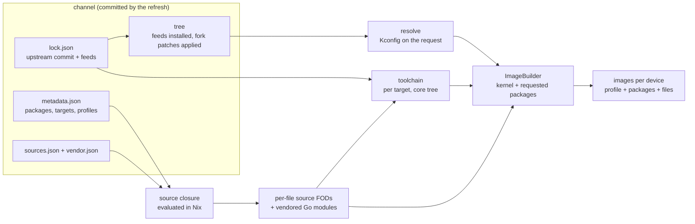

# Design

## Goal

Build ImmortalWrt firmware from source in Nix, for both upstream ImmortalWrt and its forks.

ImageBuilder-based tooling can only recombine binaries that upstream already published. That rules out devices which exist only in a fork, such as the Gemtek XR1710G. It also rules out changing the kernel, adding patches, or pinning feeds.

The OpenWrt buildroot remains the compiler. Nix supplies four things around it:

- pinned inputs;
- per-file source fetches;
- a hermetic sandbox;
- caching of build stages.

## Architecture

| Stage | Derivation | Rebuilt when |
|---|---|---|
| tree | `channels.<name>.tree` | the lock changes |
| toolchain | `channels.<name>.toolchain.<target>` | the core tree (not the feeds) changes |
| resolve | `<imagebuilder>.config` | the tree or the request changes; about a minute |
| ImageBuilder | `channels.<name>.imagebuilder { target; profiles; packages; }` | the tree, the toolchain or the request changes |
| image | `<imagebuilder>.mkImage { profile; packages; files; ... }` | anything above, or the device's own settings; seconds |

Images are always composed by an ImageBuilder, built from the channel itself. This keeps ImageBuilder semantics for package lists, and per-device changes (files, removed default packages, partition size) never rebuild packages. `mkImages` builds one ImageBuilder per target, with the union of the packages and profiles of its devices, so devices on a target share kernels and packages.

`target` is explicit (`"<target>/<subtarget>"`): profile names are not unique across targets; `generic`, for example, exists in a dozen of them. The target, the profiles and every package name are checked against `metadata.json` at evaluation time.

## Channels

A channel is one upstream line:

- a branch (`immortalwrt-snapshot`, `immortalwrt-<series>-snapshot`, `gemtek`);
- or the newest stable tag of a release series (`immortalwrt-<series>`).

`channel.json` states what to follow. It can also name a directory of per-feed patches; naoki66's fork keeps these in `patches/feeds`.

`lock.json` records:

- **version:** `SNAPSHOT`, `<series>-SNAPSHOT`, or the release version.
- **src:** the upstream commit, as a fetcher spec with its `narHash`, plus `lastModified` and the ref it was resolved from.
- **feeds:** every `src-git` line of the tree's own `feeds.conf.default`, in order. Each entry records how its pin was chosen:
  - `tree`: a release tag's `^commit`;
  - `branch`: `;branch`;
  - `default-branch`: the feed has no pin at all.
- **revision:** the `REVISION` string (`r<count>-<hash>`). Release tags ship their official `version` and `version.date` files, and those are used as-is.
- **packageVersions:** what the buildroot would derive from `.git` in a checkout: base-files' release (`COMMITCOUNT`, the number of commits touching `package/base-files`) and the version of every LuCI package (luci.mk's `findrev`, from the last commit touching the package and its `po/`). The refresh computes them from blobless clones; the tree writes them into the Makefiles, since trees have no `.git`.

Feeds are fetched as GitHub tarballs, or with `fetchgit` for other hosts. They are installed with `src-cpy`, so building a tree never touches the network. The tree also moves luci-base's host tool build out of the package directory (see Reproducibility).

## Daily refresh

`.github/workflows/refresh.yml` runs `scripts/refresh.py`, which does the following:

1. Detect the newest `openwrt-XX.YY` branch and the newest `vXX.YY.Z` release series, and create channels for any that are missing.
2. For each channel, resolve the upstream commit, pin every feed, and record `REVISION` and the package versions from git history.
3. For forks with feed patches, a feed only advances to a commit its patches still apply to. A patch whose change the feed already contains counts as applied, which matches naoki66's `scripts/apply-feed-patches.sh`. If the feed head is rejected, the refresh pins the newest commit on the feed's first-parent history that accepts the patches.
4. Prefetch everything, then build the tree, `metadata.json` and `sources.json` of every channel in the sandbox. Unchanged channels are built as well, so a change that breaks the trees shows up the same day.
5. Hash the Go modules of the packages in `vendor-packages.json` whose source file changed, into `vendor.json`.
6. Keep a channel's new state only if all of that succeeds; otherwise keep the last good one.

Channels refresh independently of each other. The refresh fits on a hosted GitHub runner: one `git ls-remote` per ref, one tarball per pinned source, a blobless clone of each upstream and feed repository for the history (about 125 MB for ImmortalWrt, 56 MB for LuCI), and per channel a tree build plus the buildroot's own scans (a few minutes).

`nixpkgs` is not updated by the refresh. Every update changes the host tools of every stage and rebuilds all of them, so it is done by hand.

## Sources

Every source file a build needs becomes a fixed-output derivation. Its hash is the one the buildroot itself declares (`PKG_HASH` / `PKG_MIRROR_HASH`), so no second set of hashes has to be maintained.

`sources.json` comes from the buildroot: `scripts/sources.py` runs `make -n -C <dir> download` for every package, `tools/` and `toolchain/` directory, which only prints the commands (about 0.1 s per Makefile). It runs once for an x86_64 and once for an aarch64 target, because a few file names depend on the architecture. Kernel tarballs come from `target/linux/generic/kernel-<version>`.

- URL sources use `fetchurl` with the tree's `scripts/projectsmirrors.json` and the source mirrors.
- Git sources are packed exactly like `include/download.mk` packs them, with a `gnutar` built with the tree's `tools/tar/patches` (otherwise long paths produce different tar headers). The fetcher tries the source mirrors first.
- A top-level `make download` is not a complete list of what a build fetches: in the spike, eight files were only downloaded during the build. The per-directory dry run covers them.

A build gets only the sources it can need, computed at evaluation time from `metadata.json`: the closure of the requested packages, the target's default packages and the profiles' device packages over

- dependencies (`+` or not, conditional ones included) and virtual names (`PROVIDES`);
- the buildroot's own directory-level build dependencies (`tmp/.packagedeps`), which include host builds such as `golang/host` and every dependency of every package in a directory: util-linux is built after ncurses because cfdisk needs it, even when nothing selects cfdisk;
- package defaults whose conditions mention the target, the profiles, `BUILDBOT` or a package in the closure;
- packages selected by the buildroot's own options (image formats select `kmod-e1000` and `grub2`) and by package config options that default on, which Kconfig does not always nest under their package (luci-app-ssr-plus selects 3proxy even when it is not built);
- the host package manager (`package/system/apk`), which `package/Makefile` builds without any package depending on it.

The closure over-approximates what Kconfig selects, so a few unused files are fetched, never too few. The sandbox is the final check: a missing file fails the build.

Go packages fetch modules at build time. For the packages in `vendor-packages.json`, `lib/vendor.nix` runs `go mod download` in a fixed-output derivation (like nixpkgs' `proxyVendor`), and the build copies the result to `dl/go-mod-cache/cache/download` and sets `GOPROXY=off`. The refresh maintains the hashes in `vendor.json`, keyed by the package directory and recomputed when the source file changes. Rust and npm packages would need the same treatment (`dl/cargo`); packages that download unhashed binaries (`PKG_HASH:=skip`) cannot be fetched reproducibly and are left out of the sources lock.

## Building in the sandbox

The buildroot needs these to run in the sandbox:

- **FHS view:** a bubblewrap view providing a `/bin` with bash and coreutils and `/usr/bin/env` (for `rules.mk`, the shebangs inside extracted tarballs and packages that call tools by absolute path, such as perl's `/bin/ln -s`), the glibc loader under `/lib64` (the Go bootstrap runs PIE executables that expect it) and `/var/lock` (minicom's configure looks for it).
- **fakeroot:** `FAKEROOTDONTTRYCHOWN=1`. The sandbox is a user namespace, so `chown(0)` fails with `EINVAL`, and libfakeroot only ignores `EPERM`.
- **cmake:** `CMAKE_INCLUDE_PATH` must point at glibc's headers so cmake's bundled libarchive finds `iconv.h`. It must not include nixpkgs' openssl, which would mix with `tools/libressl`.
- **Toolchain stamp:** the package stage writes the `toolchain/compile` stamp after copying the toolchain in. Otherwise `world` rebuilds GCC, because the build directories it would check component by component are not kept.
- **Version files:** `version` and `version.date` are needed because there is no `.git`.

Builds use the official buildbot's configuration (`BUILDBOT=y`): no per-build key in base-files, no per-package signatures, and a fixed kernel build user and host. Its other defaults are switched off where they would build more than requested: `ALL_KMODS`, `ALL_NONSHARED`, `TARGET_ALL_PROFILES`, the SDK, the toolchain archive, the CycloneDX SBOM and kernel debug collection. The ImageBuilder is built standalone (`IB_STANDALONE`), carrying every package built, and serves only the requested profiles: with `CONFIG_IB` the buildroot compiles the kernel of every device of the target, which fails for devices whose kernel embeds their own root filesystem (netgear_eax17) unless every profile is selected, so the build compiles only the requested devices' kernels. The toolchain stage uses the same target configuration, so `tools/` enables the same host tools in both stages.

Images are composed with signature checking off: the package index exists only inside the image build, and signing it would generate a random key each time.

## Kconfig

`make defconfig` silently rewrites requests:

- unknown or target-gated packages vanish;
- conflicts demote a package to `=m`;
- packages pulled in by `select` cannot be deselected;
- `luci-i18n-*` packages cannot be selected by name and only follow `LUCI_LANG_*`;
- hidden packages (such as `kmod-mt76-sdio`) cannot be selected at all, only pulled in by other packages.

Reimplementing Kconfig in Nix is not worth it. OpenWrt generates its Kconfig by evaluating every package Makefile with GNU make, which takes about 52 s; evaluating the Kconfig itself takes about 2 s. A Nix version would also have to match the C implementation bug for bug. nixpkgs takes the same approach for kernels: `generate-config.pl` runs the real `make config` and then verifies the result. This project therefore:

- checks names against `metadata.json` at evaluation time;
- translates the ImageBuilder-style request: every package becomes `=m` (so conflicting alternatives can coexist in the ImageBuilder), `luci-i18n-*-<lang>` becomes `LUCI_LANG_<lang>`, and dependencies without `+`, which Kconfig requires but does not select, are requested as well;
- runs `defconfig` in a cheap derivation (`resolve`) before any expensive stage, and fails if a requested package or profile was dropped or a selected Go package has no vendored modules.

Building only the requested kmods (no `ALL_KMODS`) means the kernel configuration differs from the official one wherever a kmod's `KCONFIG` changes it, and so does the vermagic: official kmod packages do not install on these images. Adding a package to a target can change its kernel; all devices of an ImageBuilder share it.

## Reproducibility

Measurements from the spike:

- Two independent stage-2 builds on the same machine were bit-identical (0 of 203 files differed), provided the apk signing key was fixed. This holds because OpenWrt's apk signs with RFC 6979 deterministic ECDSA. In BUILDBOT mode the per-build key only signs the build's own package index, which the ImageBuilder does not carry.
- Stage 2 was identical even on top of an independently built stage 1, although stage 1 itself differs (static archive order, a meson zipapp, and the own-store-path RUNPATH that nixpkgs' linker wrapper adds).
- Without `.git`, luci.mk versions packages by the newest mtime in the package directory, which in the store is 1970 (`0.700101.00001`); the lock's `packageVersions` replace that. For LuCI packages a fork's feed patches add, which have no history, the mtime remains, and luci-base compiles its host tools inside its package directory, which would make that mtime the build time; the tree moves that build to the host build directory.

## Roadmap

1. Run builds on a dedicated builder with the binary cache, and sign images and package indexes outside Nix.
2. Let consumers add vendored Go modules without changing this repository, and vendor Rust and npm packages.
