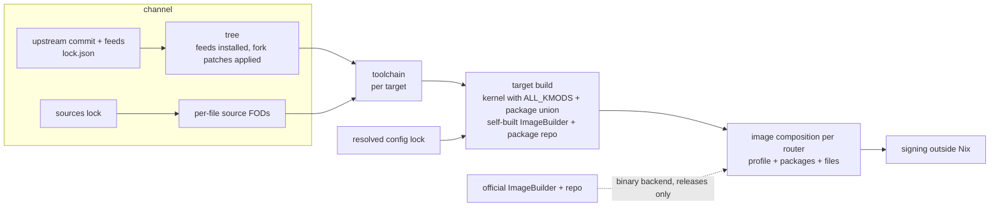

# Design

## Goal

Build ImmortalWrt firmware from source in Nix, for both upstream ImmortalWrt and its forks.

ImageBuilder-based tooling can only recombine binaries that upstream already published. That rules out devices which exist only in a fork, such as the Gemtek XR1710G. It also rules out changing the kernel, adding patches, or pinning feeds.

The OpenWrt buildroot remains the compiler. Nix supplies four things around it:

- pinned inputs;
- per-file source fetches;
- a hermetic sandbox;
- caching of build stages.

## Architecture

Images are composed by an ImageBuilder in every case: either the official one, or one built from the channel. This keeps ImageBuilder semantics for package lists, so an unknown package is an error.

Each item in the diagram has one of three states:

- **Done:** `lock.json`, the tree, the metadata, and image composition with the official ImageBuilder for release channels (`channels.<release>.mkImage`, through nix-immortalwrt-imagebuilder).
- **Proven in the feasibility spike, to be ported:** the source FODs, the toolchain stage, and the target stage.
- **Designed but not yet built:** the resolved config lock, the self-built ImageBuilder (which lets snapshot and fork channels build images), and signing.

`mkImage` takes an explicit `target` (`"<target>/<subtarget>"`). Profile names are not unique across targets; `generic`, for example, exists in a dozen of them. The target and the profile are checked against the channel's metadata before anything is built. Package names are left to the ImageBuilder: the official package repositories are rebuilt from the release branch, so they carry packages that the tag's metadata does not list.

## Channels

A channel is one upstream line:

- a branch (`immortalwrt-snapshot`, `immortalwrt-<series>-snapshot`, `gemtek`);
- or the newest stable tag of a release series (`immortalwrt-<series>`), counting only tags whose official binaries nix-immortalwrt-imagebuilder has pinned, so `mkImage` never points at a release that cannot be built.

`channel.json` states what to follow. It can also name a directory of per-feed patches; naoki66's fork keeps these in `patches/feeds`.

`lock.json` records:

- **version:** `SNAPSHOT`, `<series>-SNAPSHOT`, or the release version.
- **src:** the upstream commit, as a fetcher spec with its `narHash`, plus `lastModified` and the ref it was resolved from.
- **feeds:** every `src-git` line of the tree's own `feeds.conf.default`, in order. Each entry records how its pin was chosen:
  - `tree`: a release tag's `^commit`;
  - `branch`: `;branch`;
  - `default-branch`: the feed has no pin at all.
- **revision:** the `REVISION` string (`r<count>-<hash>`). Release tags ship their official `version` and `version.date` files, and those are used as-is.

Feeds are fetched as GitHub tarballs, or with `fetchgit` for other hosts. They are installed with `src-cpy`, so building a tree never touches the network.

## Daily refresh

`.github/workflows/refresh.yml` first runs `nix flake update` (which also brings in newly pinned release binaries) and then `scripts/refresh.py`. The script does the following:

1. Detect the newest `openwrt-XX.YY` branch and the newest published `vXX.YY.Z` release series, and create channels for any that are missing.
2. For each channel, resolve the upstream commit and pin every feed.
3. For forks with feed patches, a feed only advances to a commit its patches still apply to. A patch whose change the feed already contains counts as applied, which matches naoki66's `scripts/apply-feed-patches.sh`. If the feed head is rejected, the refresh pins the newest commit on the feed's first-parent history that accepts the patches.
4. Prefetch everything, then build the tree and metadata of every channel in the sandbox. Unchanged channels are built as well, so a flake input update that breaks the trees shows up the same day.
5. Keep a new lock only if that build succeeds; otherwise keep the last good one.

Channels refresh independently of each other.

Resource use is small, which is why the refresh fits on a hosted GitHub runner:

- one `git ls-remote` per ref;
- one tarball per pinned source (26 sources, 1.4 GB unpacked, across today's four channels);
- a treeless clone (about 40 MB for ImmortalWrt) to count commits for `REVISION`;
- a tree build plus the buildroot's own scan (`make prepare-tmpinfo`, about a minute) per channel.

Full firmware builds are a different matter. Stage 1 alone took 18 minutes on 48 cores in the spike. They therefore belong on a dedicated builder with a binary cache, not on hosted runners.

The official snapshot binaries are replaced every day, so a pinned snapshot ImageBuilder stops being downloadable after a day. For that reason, snapshot channels use the source backend only.

## Sources

Every source file a build needs becomes a fixed-output derivation. Its hash is the one the buildroot itself declares (`PKG_HASH` / `PKG_MIRROR_HASH`), so no second set of hashes has to be maintained. The spike settled several details:

- URL sources use `fetchurl` together with the tree's `scripts/projectsmirrors.json`.
- Git sources must be packed exactly like `include/download.mk` packs them, using a `gnutar` built with the tree's `tools/tar/patches`. Otherwise long paths produce different tar headers. The fetcher also tries the source mirrors first.
- A top-level `make download` is not a complete list of what a build fetches. Eight files were only downloaded during the build. It also needs `tools/` to be compiled first.
- The sources lock is therefore generated per package with `make -n -C <pkg> download`. This only prints the commands, at roughly 0.1 s per Makefile.
- Generation runs per channel × target, because a few file names depend on the target architecture. The sandbox is the final check: any missing file fails loudly.
- Go, Rust and npm packages fetch dependencies at build time. They need vendor FODs placed in `dl/go-mod-cache` and `dl/cargo`, with hashes maintained like nixpkgs' `vendorHash`. Packages that download unhashed binaries (`PKG_HASH:=skip`) must be patched or dropped.

## Building in the sandbox

The spike found these requirements:

- **FHS view:** a bubblewrap view providing `/bin/sh`, `/bin/bash` and `/usr/bin/env`, because of `rules.mk` and the shebangs inside extracted tarballs.
- **fakeroot:** `FAKEROOTDONTTRYCHOWN=1`. The sandbox is a user namespace, so `chown(0)` fails with `EINVAL`, and libfakeroot only ignores `EPERM`.
- **cmake:** `CMAKE_INCLUDE_PATH` must point at glibc's headers so cmake's bundled libarchive finds `iconv.h`. It must not include nixpkgs' openssl, which would mix with `tools/libressl`.
- **Toolchain stamp:** stage 1 has to write the toolchain/compile stamp. Otherwise `world` rebuilds GCC.
- **Version files:** `version` and `version.date` are needed because there is no `.git`. The tree derivation writes them.

## Reproducibility

Measurements from the spike:

- Two independent stage-2 builds on the same machine were bit-identical (0 of 203 files differed), provided the apk signing key was fixed. This holds because OpenWrt's apk signs with RFC 6979 deterministic ECDSA.
- Stage 2 was identical even on top of an independently built stage 1, although stage 1 itself differs (static archive order, a meson zipapp, and the own-store-path RUNPATH that nixpkgs' linker wrapper adds).

What remains to handle:

- **Keys.** apk-based trees generate a random EC key on every build and install its public half into base-files. Build in BUILDBOT mode instead (no per-build key, no per-package signatures), sign the index outside Nix, and ship our own public key through a keyring package. Never let `private-key.pem` or `key-build*` reach the store through `src`.
- **BUILDBOT side effects.** BUILDBOT also enables `ALL_NONSHARED`, SDK, IB and attended-sysupgrade defaults. Each needs explicit overrides and extra sources.
- **luci.mk versions.** Without `.git`, luci.mk versions packages by the newest mtime in the package directory. The tree must stay read-only, with patches applied when the tree is built and never during the build. Proper per-package versions need a version table generated while refreshing, where `.git` is available.

## Kconfig

`make defconfig` silently rewrites requests:

- unknown or target-gated packages vanish;
- conflicts demote a package to `=m`;
- packages pulled in by `select` cannot be deselected;
- `luci-i18n-*` packages cannot be selected by name and only follow `LUCI_LANG_*`.

The fountain-of-lucine bundles lose 24 to 27 packages each when applied to the XR1710G target, with no error.

Reimplementing Kconfig in Nix is not worth it. OpenWrt generates its Kconfig by evaluating every package Makefile with GNU make, which takes about 52 s; evaluating the Kconfig itself takes about 2 s. A Nix version would also have to match the C implementation bug for bug. nixpkgs takes the same approach for kernels: `generate-config.pl` runs the real `make config` and then verifies the result. This project therefore:

- checks names against `metadata.json` at evaluation time;
- runs `conf` in a cheap derivation before any expensive stage and fails if a requested package was dropped;
- commits the resolved package set per channel × target as a config lock;
- translates ImageBuilder-style package lists, for example `luci-i18n-*` into `LUCI_LANG_*`;
- follows the official buildbot for the kernel stage (`ALL_KMODS`), because kmod `KCONFIG` entries otherwise change the kernel and its vermagic.

## Roadmap

1. Port the spike's source FODs and stages. Build XR1710G from the `gemtek` channel, with image composition through the self-built ImageBuilder, so the channel gets `mkImage` like the release channels.
2. Add the config lock, the resolve check and the package-list translation. Add vendor FODs for Go, Rust and npm. Build the full `1710.config` package set.
3. Let release channels choose the source backend as well, so release images can carry patches.
4. Run builds on a dedicated builder with a binary cache, and sign outside Nix.
